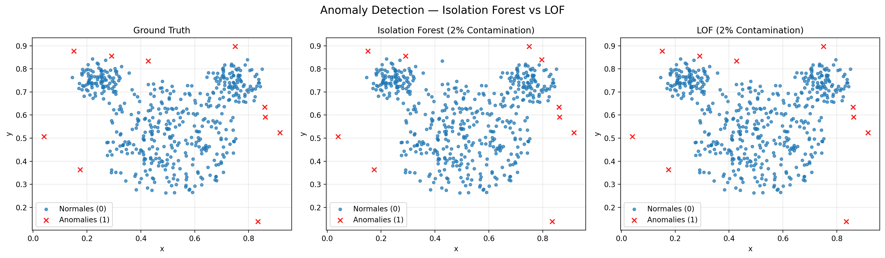
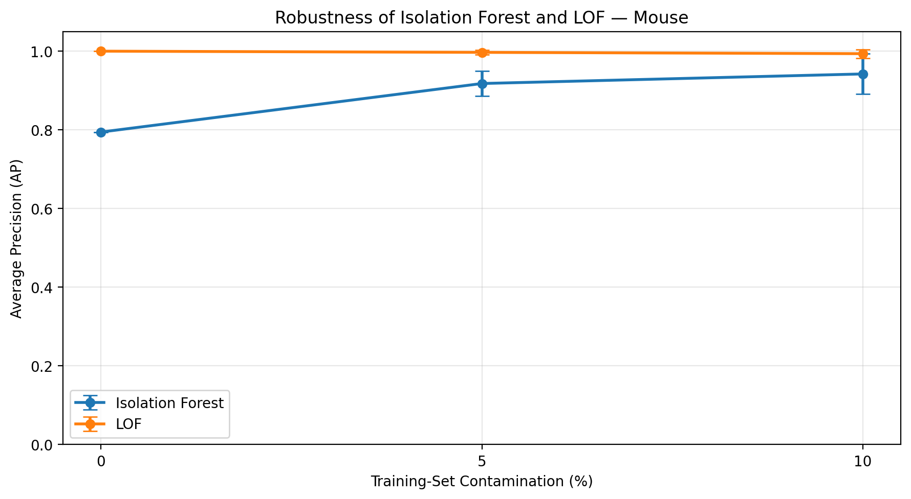
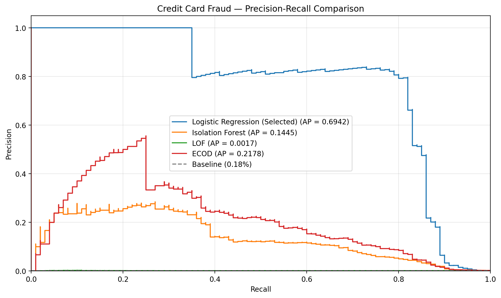
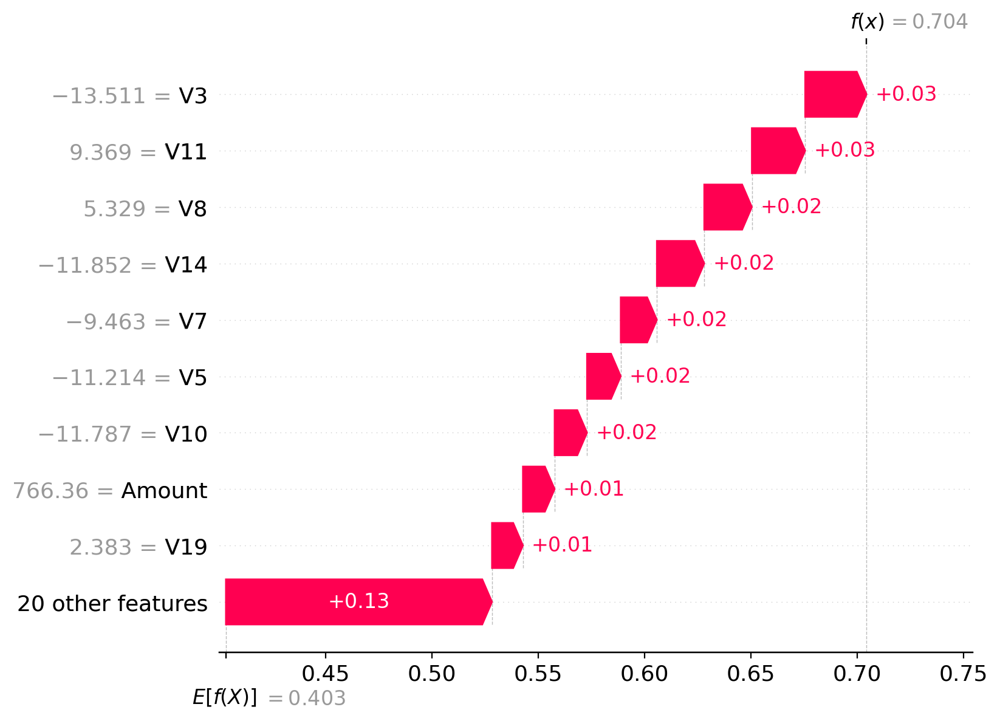
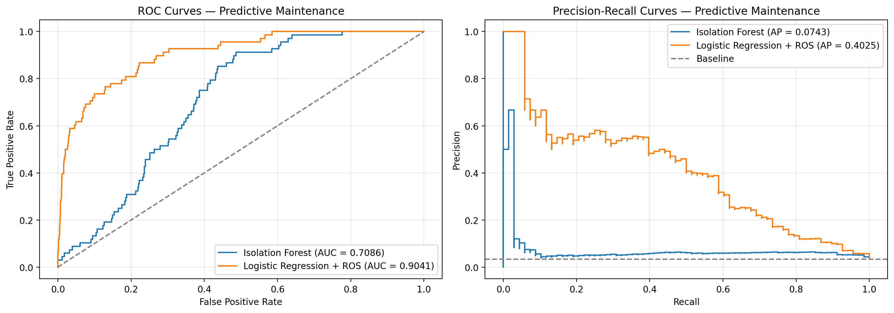

# Anomaly Detection — Machine Learning Benchmark

A comparative machine learning project exploring **supervised and unsupervised anomaly detection** across three application domains: synthetic spatial anomalies, credit card fraud detection, and predictive maintenance.

The project focuses on data preprocessing, class imbalance, anomaly scoring, threshold optimization, model evaluation, and interpretability.

## Project Overview

Anomaly detection aims to identify rare observations that differ significantly from normal patterns. These observations may represent fraudulent transactions, industrial failures, or unusual data points.

This project investigates how different machine learning approaches perform across datasets with different characteristics and operational constraints.

### Objectives

- Compare supervised and unsupervised anomaly detection methods.
- Develop reproducible data preprocessing workflows.
- Handle highly imbalanced datasets.
- Evaluate anomaly scores and optimize decision thresholds.
- Analyze false positives and false negatives.
- Investigate model robustness and interpretability.

## Use Cases

### 1. Mouse — Unsupervised Anomaly Detection

**Dataset:** 500 observations, including 10 anomalies (2%).

**Methods:**
- Isolation Forest
- Local Outlier Factor (LOF)
- IQR-based threshold selection
- K-Means and DBSCAN applied to anomaly scores
- LOF novelty detection
- Robustness analysis under synthetic training contamination

**Key findings:**

LOF achieved an F1-score of 1.00 for several outlier detection configurations evaluated on the observed dataset.

In the separate novelty detection experiment, LOF detected all 10 test anomalies with four false positives, obtaining an F1-score of 0.8333.

These results highlight the importance of distinguishing in-sample outlier detection from novelty detection on unseen observations.


#### Anomaly Detection Comparison



Comparison of ground-truth anomalies and predictions from Isolation Forest and LOF. LOF correctly identifies all 10 anomalies, while Isolation Forest misses one anomaly and generates one false positive.

#### Robustness to Training Contamination



Average Precision across different training contamination levels (0%, 5%, and 10%). Error bars represent variability across three random seeds.


### 2. Credit Card Fraud Detection

**Dataset:** 284,807 transactions with approximately 0.17% fraudulent transactions.

**Methods:**
- Logistic Regression
- Decision Tree
- Isolation Forest
- Local Outlier Factor
- ECOD
- RandomOverSampler
- SHAP explanations

**Evaluation strategy:**

Data is divided into training, validation, and test sets. Models and decision thresholds are selected using validation data.

The operational objective is to maximize fraud recall while maintaining precision of at least 80% on validation.

**Key findings:**

The selected Logistic Regression model with RandomOverSampler achieved the following results on the test set:

| Metric | Result |
|---|---:|
| Precision | 79.31% |
| Recall | 72.63% |
| F1-score | 0.7582 |
| True Positives | 69 |
| False Positives | 18 |
| False Negatives | 26 |

Although the precision constraint was met during validation, test precision fell slightly below 80%.

SHAP was also used to investigate how individual features contribute to Isolation Forest anomaly scores.


#### Precision-Recall Comparison



Comparison of supervised and unsupervised approaches on the validation set, using Average Precision to assess fraud detection performance.

#### Model Explainability — SHAP



SHAP waterfall plot explaining the Isolation Forest anomaly score of a correctly detected fraudulent transaction.

Additional explanations:
- [False Positive (FP)](figures/credit_card/shap_fp.png)
- [False Negative (FN)](figures/credit_card/shap_fn.png)


### 3. Predictive Maintenance — AI4I 2020

**Dataset:** 10,000 synthetic machine observations, including 339 failures (3.39%).

**Methods:**
- Isolation Forest
- Logistic Regression with RandomOverSampler
- OneHotEncoder and StandardScaler
- Precision-constrained threshold selection

The operational objective is to maximize failure recall while maintaining at least 90% precision on validation.

**Test results:**

| Model | Average Precision | ROC-AUC | Failures Detected |
|---|---:|---:|---:|
| Isolation Forest | 0.0743 | 0.7086 | 0 / 68 |
| Logistic Regression + ROS | 0.4025 | 0.9041 | 3 / 68 |

Logistic Regression demonstrated better ranking performance, but the selected threshold produced very low failure recall.

This illustrates that strong ranking metrics do not necessarily translate into effective operational decisions under strict precision constraints.


#### Model Performance Comparison



ROC and Precision-Recall curves comparing Isolation Forest and Logistic Regression with RandomOverSampler on the held-out test set.

Despite stronger ranking performance, Logistic Regression detects only 3 of the 68 failures under the selected precision-constrained threshold.


## Technology Stack

- **Language:** Python
- **Data manipulation:** Pandas, NumPy
- **Machine Learning:** Scikit-learn, PyOD
- **Imbalanced learning:** Imbalanced-learn
- **Visualization:** Matplotlib, Seaborn
- **Model interpretability:** SHAP
- **Dataset access:** KaggleHub
- **Development:** Jupyter Notebook

## Repository Structure

```text
anomaly-detection-ml/
│
├── notebooks/
│   ├── 01_mouse_anomaly_detection.ipynb
│   ├── 02_credit_card_fraud.ipynb
│   └── 03_predictive_maintenance.ipynb
│
├── src/
│   ├── __init__.py
│   └── utils.py
│
├── data/
│   ├── mouse.txt
│   └── README.md
│
├── figures/
├── results/
│
├── README.md
├── requirements.txt
└── .gitignore
```

## Installation and Usage

### 1. Clone the repository

```bash
git clone https://github.com/MostafaH00/anomaly-detection-ml.git
cd anomaly-detection-ml
```
### 2. Create a virtual environment

```bash
python -m venv .venv
```

Activate it on Windows:

```powershell
.venv\Scripts\Activate.ps1
```

Or on Linux/macOS:

```bash
source .venv/bin/activate
```

### 3. Install dependencies

```bash
python -m pip install -r requirements.txt
```

### 4. Access datasets

The Credit Card Fraud and AI4I datasets are accessed using KaggleHub.

The corresponding notebooks use local CSV files when available and otherwise download the datasets into the KaggleHub cache.

An Internet connection may be required for the initial download.

For dataset sources and additional information, see [data/README.md](data/README.md).

### 5. Run the notebooks

Open the `notebooks/` directory using VS Code or Jupyter and execute each notebook from top to bottom.

Each notebook is designed to run independently using the shared functions in `src/utils.py`.

## Evaluation Methodology

The experiments use several complementary evaluation metrics:

- **Precision:** Proportion of detected anomalies that are genuine.
- **Recall:** Proportion of actual anomalies successfully detected.
- **F1-score:** Harmonic mean of precision and recall.
- **Average Precision (AP):** Summary of precision-recall performance across decision thresholds.
- **ROC-AUC:** Ranking quality of model scores.
- **Balanced Accuracy:** Average sensitivity across the two classes.

Training and scoring times are also measured to assess computational costs.

For supervised experiments, preprocessing and resampling are performed using training data only. Validation data supports model and threshold selection, while test data is reserved for final evaluation.

## Limitations

- The Mouse dataset contains only 10 anomalies, limiting the reliability of performance estimates.
- Some Mouse experiments evaluate outlier detection on the same observations used for model fitting.
- The Credit Card dataset uses an anonymized feature representation and a non-chronological split.
- AI4I contains synthetic observations rather than real industrial maintenance records.
- Thresholds selected on validation data do not guarantee that operational constraints will hold on unseen data.
- The three datasets have different anomaly frequencies, so their performance metrics should be interpreted within their respective contexts.

## Conclusion

This project demonstrates how anomaly detection performance depends on the dataset, learning strategy, evaluation protocol, and decision threshold.

It highlights the importance of combining statistical evaluation with operational constraints, particularly when false positives and false negatives have different consequences.

The experiments also demonstrate that unsupervised anomaly scores can be useful for ranking unusual observations without necessarily providing accurate classifications under demanding precision constraints.

## Dataset Sources

- [Credit Card Fraud Detection — Kaggle](https://www.kaggle.com/datasets/mlg-ulb/creditcardfraud)
- [AI4I 2020 — UCI Machine Learning Repository](https://archive.ics.uci.edu/dataset/601/ai4i)

---

**Project type:** Machine Learning / Data Science Portfolio